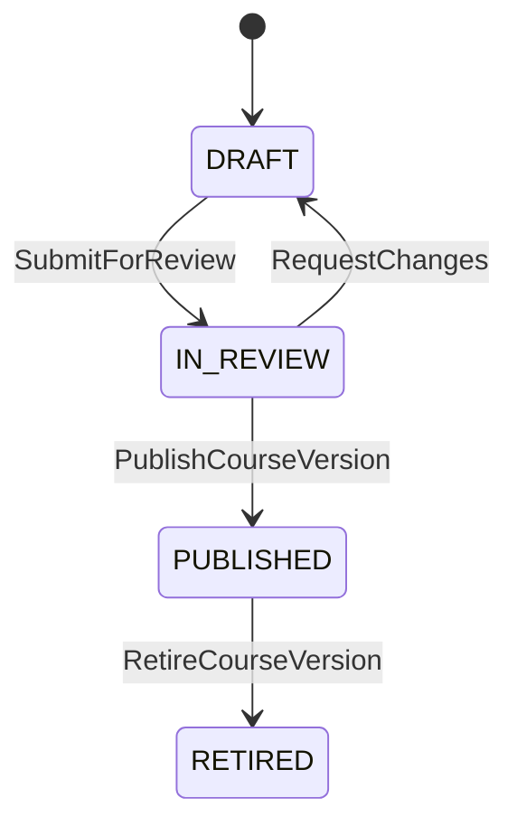

# LearningHub - Machines à états et invariants R0 réconciliés

> **Synthèse publique R0/R1 - draft.** Les éléments tirés des spécifications de conception sont des contrats candidats, pas des interfaces livrées ni des décisions approuvées. Les originaux restent hors de ce dépôt public.

## Source de travail et niveau d'autorité

Réconcilié avec `R0_LEARNINGHUB_STATE_MACHINES_AND_INVARIANTS.md` (24 novembre 2026, version `1.0.0-draft`, `PROPOSED`). Les états ci-dessous sont **ceux du modèle source**. Les détails de chaque garde et transition, non reproduits intégralement ici, doivent être vérifiés dans cette source avant développement.

## Registre des sept machines

| Agrégat | États selon R0 | Invariant à vérifier |
|---|---|---|
| `CourseVersion` | `DRAFT`, `IN_REVIEW`, `PUBLISHED`, `RETIRED` | Pas de publication directe sans revue ; snapshot immuable après publication |
| `Enrollment` | `PENDING`, `ACTIVE`, `SUSPENDED`, `COMPLETED`, `CANCELLED` | Réinscription par cycle explicite ; suspension pédagogique distincte d'une révocation marchande |
| `AccessGrant` | `PENDING`, `ACTIVE`, `SUSPENDED`, `REVOKED`, `EXPIRED` | Droit par source + scope ; `REVOKED` et `EXPIRED` terminaux |
| `Attempt` | `CREATED`, `IN_PROGRESS`, `SUBMITTED`, `GRADING`, `GRADED`, `EXPIRED`, `INVALIDATED` | Tentative liée à une `AssessmentVersion` figée ; pas de double soumission |
| `CompletionRecord` | `PENDING`, `ACHIEVED`, `REJECTED`, `UNDER_REVIEW`, `INVALIDATED` | Décision selon preuves et policy ; revue possible d'un état atteint |
| `Credential` | `PENDING`, `ISSUED`, `SUSPENDED`, `REVOKED`, `EXPIRED`, `FAILED` | Justificatif issu d'une réussite admissible, avec état de vérification fiable |
| `EntitlementMirror` (R2) | `source_status` = `PENDING`, `ACTIVE`, `SUSPENDED`, `REVOKED`, `EXPIRED` ; `sync_status` = `UNVERIFIED`, `CURRENT`, `STALE`, `QUARANTINED`, `RECONCILING` | Une projection commerciale `ACTIVE` mais `STALE` n'accorde pas automatiquement l'accès |

## Transitions critiques R1

### Version de cours

L'état `IN_REVIEW` est une étape obligatoire : l'ancienne synthèse `DRAFT -> PUBLISHED` était incomplète et ne doit pas servir de contrat.

### Enrollment, droit et progression

- `Enrollment.PENDING -> ACTIVE` : activation explicite après contrôles de version, de scope et de droits requis par politique.
- `Enrollment.ACTIVE -> COMPLETED` : un `CompletionRecord.ACHIEVED` admissible existe pour le bon enrollment/version.
- `AccessGrant.SUSPENDED -> ACTIVE` : reprise possible si la cause est levée et la source est encore valable.
- `AccessGrant.REVOKED / EXPIRED -> ACTIVE` : **interdit** ; créer une nouvelle génération de droit selon la policy.
- `Attempt.CREATED -> IN_PROGRESS -> SUBMITTED -> GRADING -> GRADED` : progression transactionnelle, autres issues `EXPIRED` ou `INVALIDATED` selon guards.
- `CompletionRecord.ACHIEVED -> UNDER_REVIEW -> ACHIEVED / INVALIDATED` : revue historisée, pas une réécriture silencieuse.

## Contrats transactionnels

Chaque commande contrôle : authentification, tenant, object scope, schéma de commande, clé d'idempotence, révision attendue, transition, guards, audit et outbox en transaction. Les événements externes validés deviennent une **commande locale** et ne modifient jamais directement un champ de statut.

## Cas restant à arbitrer

- Unicité des cycles Enrollment et cas `cohort_id=NULL`.
- `retirement_access_policy` des CourseVersion retirées.
- Fraîcheur, révocation et génération d'AccessGrant.
- Cas de refus après revue de CompletionRecord et nom exact de l'événement.
- Politique d'émission, expiration et révocation d'un Credential.

Voir [réconciliation et écarts](07-r0-r1-source-reconciliation.md) et [stratégie de test](../06-validation/01-test-strategy-and-acceptance.md).
